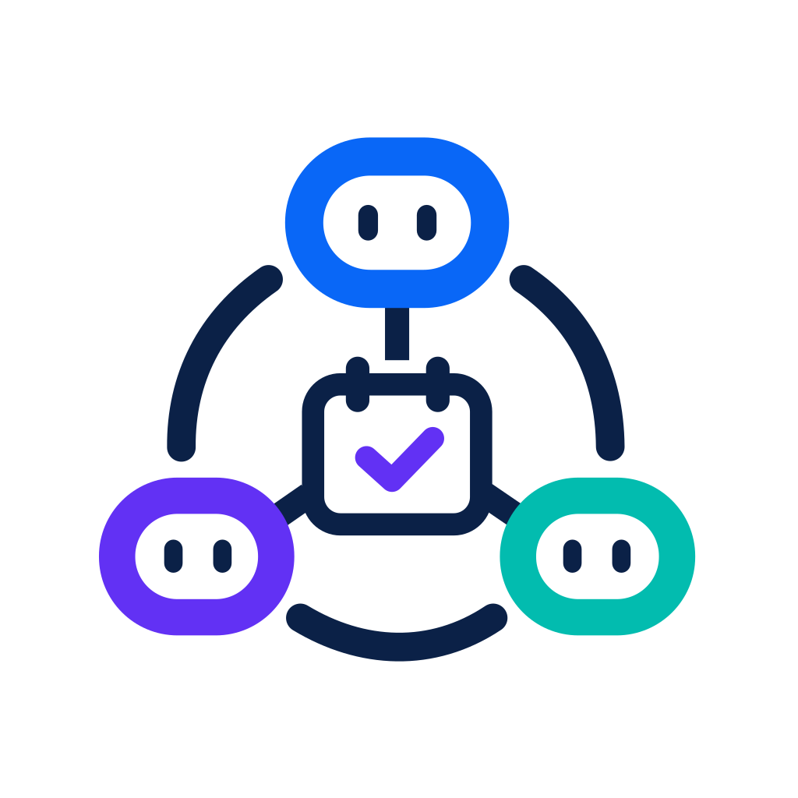
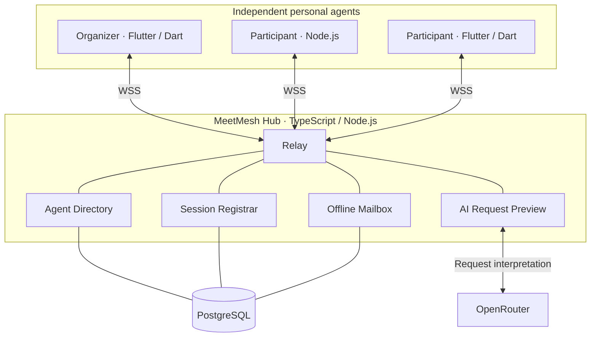
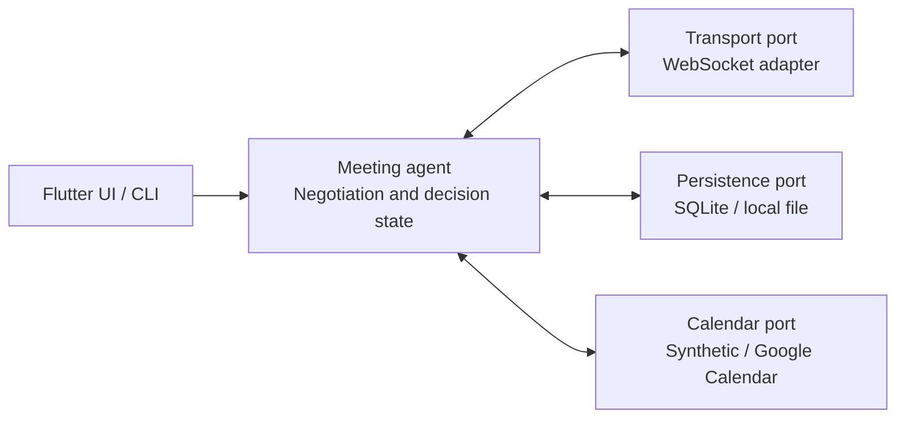
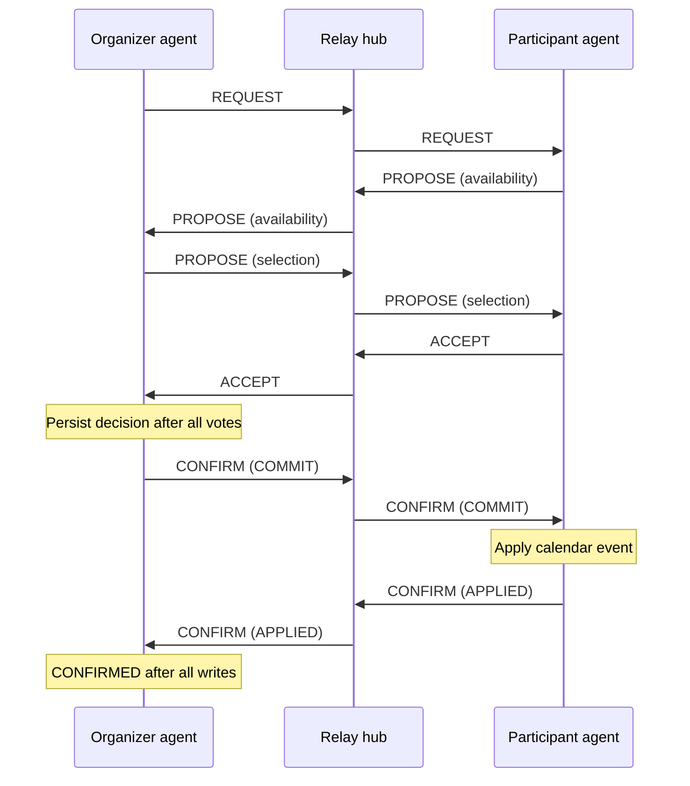

<div align="center">



# MeetMesh

### Your agents talk. Your calendars stay private.

A relay-based multi-agent meeting scheduling system that lets personal software agents discover one another, negotiate a common time, and coordinate calendar updates — without exchanging the contents of existing calendar events.

[](apps/mobile)
[](apps/agent-node)
[](apps/hub)
[](infra/local)
[](https://github.com/batuhanynr/MeetMesh/actions/workflows/ci.yml)

[How it works](#how-it-works) · [Architecture](#architecture) · [Quick start](#quick-start) · [Evaluation](#evaluation) · [Team](#team)

**Gebze Technical University · CSE476 · 2026**

</div>

---

## The idea

What if, instead of people repeatedly asking *“When are you free?”*, their personal agents could work it out together?

MeetMesh explores how the Internet can support **agent-to-agent communication** through a practical use case: scheduling a meeting. Each participant has an independent software agent that knows their availability. The agents exchange candidate slots, agree on a time, and apply the decision to their respective calendars.

The central hub connects the agents, but **it does not decide when they meet**. Scheduling belongs to the agents themselves.

> A shared meeting decision, not a shared calendar.

## How it works

Imagine asking MeetMesh:

> “Yarın Ada ve Ece ile yarım saatlik bir toplantı ayarla.”
>
> *Schedule a 30-minute meeting with Ada and Ece tomorrow.*

| Step | What happens |
| :--- | :--- |
| **01 · Understand** | The optional AI preview converts the Turkish request into an editable draft: participants, time window and duration. |
| **02 · Discover** | The Agent Directory resolves visible profiles to stable agent identities. The user reviews the draft and confirms it. |
| **03 · Negotiate** | The organizer's agent requests availability, ranks mutually available slots, and proposes a candidate. |
| **04 · Agree** | Each participant checks its own calendar and accepts or rejects the proposed slot. |
| **05 · Apply** | After unanimous acceptance, the organizer commits the decision. Each agent writes to its own calendar. |
| **06 · Confirm** | The meeting is confirmed only after every participant reports that its calendar write was applied. |

The structured scheduling form works without an LLM. The AI assists with understanding the request; it does not make the scheduling decision.

## What makes MeetMesh different?

| | |
| :--- | :--- |
| **Agent-to-agent negotiation** | Independent agents coordinate a group meeting using a shared, versioned JSON message contract. |
| **Privacy by design** | Scheduling exchanges free/busy information and candidate slots rather than existing event titles or descriptions. |
| **Mobile-first connectivity** | Outbound WebSocket connections through a relay avoid requiring phones to accept inbound peer connections. |
| **Offline-aware messaging** | A durable mailbox holds messages for disconnected agents; reconnects, bounded retries and delivery receipts support recovery. |
| **Consistent calendar updates** | Durable reservations, decision IDs and idempotent event writes help prevent conflicting decisions and duplicate calendar entries. |
| **Cross-runtime design** | A Flutter/Dart agent and a Node.js reference agent interoperate through the same protocol. |
| **Natural-language assistance** | OpenRouter provides an optional, editable meeting preview. Manual scheduling and synthetic-calendar demos remain independent of AI. |
| **Real calendar integration** | Google Calendar adapters support reading availability and writing confirmed meetings with user authorization. |

## Architecture

MeetMesh introduces two application-level abstractions inspired by traditional networking: a **DNS-like Agent Directory** and an **Agent Communication Layer** built on existing Internet protocols. No changes to DNS, TCP/IP or the underlying Internet infrastructure are required.



| Component | Responsibility |
| :--- | :--- |
| **Relay** | Routes protocol messages to their intended recipient. |
| **Directory** | Finds visible agents by name or identity; handles profile discovery. |
| **Registrar** | Authenticates agents and tracks active sessions. |
| **Mailbox** | Persists messages for offline recipients and forwards them on reconnect. |
| **AI preview** | Interprets a natural-language request into a user-reviewable draft. |
| **Personal agents** | Own scheduling logic, availability, local votes, recovery, and calendar effects. |

### Ports & adapters

The meeting domain is separated from network, persistence and calendar implementations using hexagonal architecture. Node.js agents persist state in SQLite; mobile agents use local file storage, while the hub uses PostgreSQL. The calendar port supports synthetic fixtures and Google Calendar adapters.



### The meeting protocol

The organizer coordinates the agreement. The diagram shows one representative participant; for a group meeting, the organizer tracks every participant's vote and calendar-write receipt individually. All agent-to-agent messages travel through the hub.



Transport acknowledgments are separate from acceptance or calendar application. A failed delivery is not a vote, and a committed decision is not considered fully applied until every calendar write is acknowledged.

Explore the [protocol contract](packages/protocol/README.md), [JSON schema](packages/protocol/schemas/message.schema.json), and [scheduling state machine](docs/m3.md).

## Reliability, security & privacy

MeetMesh is designed around the realities of unreliable mobile networks and independent participants.

| Mechanism | Purpose |
| :--- | :--- |
| **WSS / TLS** | Encrypted client–hub transport with certificate validation. |
| **Authenticated sessions** | Binds a stable agent ID to an authenticated session. |
| **Pairwise HMAC** | Protects the integrity and origin of signed agent messages. |
| **Replay protection** | Persistent nonce and message tracking rejects replayed or conflicting messages. |
| **Durable inbox / outbox** | Persists message processing and recovery state. |
| **Bounded retries** | Exhausted retries remain visible as `DELIVERY_UNCONFIRMED`. |
| **Idempotent calendar effects** | Stable event keys prevent repeated messages from creating duplicate calendar entries. |

**Trust boundary:** TLS protects each connection, not the content end to end. The relay can read forwarded messages, and managed calendar authorization can involve the hub. Existing calendar titles and descriptions are not exchanged in agent negotiation. If AI preview is enabled, the request text is sent to OpenRouter and the configured model provider. Development key provisioning is not a production key-management system.

See [ADR 002 — persistence and security](docs/decisions/002-m2-hub-persistence-and-security.md).

## Technology stack

| Layer | Technologies |
| :--- | :--- |
| Mobile application | Flutter · Dart · Android / iOS targets |
| Reference agent and hub | Node.js 26 · TypeScript |
| Communication | WebSocket / WSS · TLS · JSON Schema · HMAC |
| Persistence | PostgreSQL · SQLite · local mobile storage |
| Intelligence | OpenRouter API |
| Calendars | Synthetic fixtures · Google Calendar API |
| Evaluation | Node test runner · Flutter tests · Docker network lab · GitHub Actions |

## Quick start

Try the protocol locally before setting up a phone or connecting any real calendar. An OpenRouter API key is **not required** for the core demos.

### Setup

Requirements: Node.js 26, npm 11, and optionally Docker for the bundled PostgreSQL and network lab. For mobile development use Flutter 3.38.7 / Dart 3.10.7.

```bash
git clone https://github.com/batuhanynr/MeetMesh.git
cd MeetMesh
npm ci --ignore-scripts
cp .env.example .env
npm run check
npm run build
npm run doctor
```

### 1. Local protocol demo

```bash
npm run demo:m1
```

Or start an interactive local cluster (one hub and three independent agents):

```bash
npm run local
```

Check `http://127.0.0.1:8787/health` from another terminal. Ctrl+C stops the cluster. Once stopped, `npm run local:reset` clears synthetic local state while retaining identity ownership.

### 2. Authenticated relay

```bash
npm run db:up
npm run certs
npm run secrets
npm run demo:m2
```

An existing PostgreSQL instance can replace Docker by setting `DATABASE_URL` in the ignored root `.env`. The bundled database listens on port 5433. Development certificates and credentials are generated under `.state/`; do not commit them.

### 3. Scheduling and mobile

For scheduling and mixed-runtime tests, configure **disposable test databases** as documented in the [scheduling guide](docs/m3.md) and [M5 verification guide](docs/evidence/m5/README.md). These demos reset test tables; never target a database containing real user data.

```bash
cd apps/mobile
flutter pub get
cd ../..
npm run demo:m3
npm run demo:m5
```

To run the actual Flutter app on a device, follow the [mobile setup guide](apps/mobile/README.md) for hub provisioning, certificates, account files and Google Calendar authorization.

<details>
<summary><b>Enable optional natural-language preview</b></summary>

<br/>

Configure `OPENROUTER_API_KEY` in the ignored root `.env` (or the private key file described in the [model guide](docs/m5-intelligence.md)). Set `OPENROUTER_MODEL` to select a supported model.

After configuring the mixed demo's database and credentials:

```bash
npm run demo:m5 -- --preview
```

</details>

## Evaluation

The project was developed in five milestones, from a transport protocol to a cross-runtime mobile scheduling system. Recorded results are linked to specific tested revisions rather than presented as guarantees for every environment.

| Milestone | Scope | Recorded evidence |
| :--- | :--- | :--- |
| M1 | Message contract, delivery and isolated agent processes | [10/10 real-network scenarios](docs/evidence/m1/README.md) |
| M2 | WSS, discovery, authentication and durable mailbox | [4 authenticated WSS scenarios passed in the M5 gate](docs/evidence/m5/gate.json) |
| M3 | Deterministic scheduling and recovery | [20 normal + 6 recovery scenarios passed](docs/evidence/m3/gate.json) |
| M4 | Network impairment and reconnection | [Recorded smoke and partial benchmark results](docs/evidence/m4/README.md) |
| M5 | Flutter, AI preview and Node/Dart interoperability | [Mixed scheduling gate passed](docs/evidence/m5/gate.json) |

In the recorded M5 mixed-runtime run, two Node.js agents and one Dart agent reached a common decision over WSS, each produced exactly one synthetic calendar event, and the Dart event remained present after reopening. Flutter analysis and five Flutter tests also passed in that run.

The archived network matrix is incomplete and includes failures. Signed device installation, the full network matrix, NVIDIA Air verification and a live Google Calendar run are not established by the archived verification records. See the [remaining acceptance checks](docs/evidence/m5/README.md) for the precise verification scope.

<details>
<summary><b>Reproduce the validation gates</b></summary>

### M1 demo and verification

```bash
npm run demo:m1
npm run test:gate:m1
npm run check:mobile
```

M1 is a transport-only test using synthetic effects, not a calendar scheduling demo. Use `npm run test:protocol`, `npm run test:unit` and `npm run test:integration` for individual suites. The M1 gate records evidence in `.state/evidence/m1/`; the demo writes to `.state/evidence/demo-m1/`.

### M2 demo and verification

Prepare PostgreSQL, certificates and secrets as in [Authenticated relay](#2-authenticated-relay) above, then use a disposable database for the gate.

```bash
npm run demo:m2
npm run test:gate:m2
```

For interactive control, run these in separate terminals:

```bash
npm run hub:m2
npm run agent:m2 -- --id agent-a
npm run agent:m2 -- --id agent-b
npm run agent:m2 -- --id agent-c
```

Agents accept JSON-line commands on stdin. See the [reference agent guide](apps/agent-node/README.md) and [M2 status record](docs/m2-status.md).

### Scheduling and mobile gates

Use dedicated disposable test databases and install Flutter dependencies before running these commands.

```bash
npm run test:gate:m3
npm run test:gate:m5
npm run verify:acceptance -- --session=release-check
```

See [M5 verification](docs/evidence/m5/README.md) for prerequisites, serial execution, evidence handling and resuming a stopped acceptance run.

</details>

## Repository structure

```text
MeetMesh/
├── apps/
│   ├── hub/           Relay, discovery, sessions, mailbox, AI preview
│   ├── agent-node/    Independent TypeScript reference agent
│   └── mobile/        Flutter application and Dart agent core
├── packages/
│   ├── protocol/      Portable schemas, validators and fixtures
│   ├── runtime/       Runtime configuration and structured logging
│   └── intelligence/ Request interpretation fixtures
├── infra/             PostgreSQL, network lab and Air setup
├── scripts/           Demos, orchestration and acceptance tools
├── tests/             Protocol, unit, integration and scheduling tests
├── docs/              Architecture decisions and recorded evidence
└── assets/            MeetMesh visual identity
```

## Documentation

| Resource | Description |
| :--- | :--- |
| [Project proposal](CSE476_MeetMesh_Proposal.pdf) | Original academic proposal and project motivation |
| [Runtime and routing](docs/decisions/001-runtime-and-routing.md) | Relay and runtime design decisions |
| [Hub design](apps/hub/README.md) | Local and authenticated hub modes |
| [Protocol](packages/protocol/README.md) | Message semantics and validation rules |
| [Reference agent](apps/agent-node/README.md) | CLI and independent agent operation |
| [Mobile guide](apps/mobile/README.md) | Phone demos and calendar setup |
| [AI preview](docs/m5-intelligence.md) | External model configuration |
| [Network lab](infra/network/README.md) | Fault injection and network evaluation |
| [Verification](docs/evidence/m5/README.md) | Reproducible acceptance procedures |

## Team

Developed by **Batuhan Yanar** and **Tuana Melisa Aksoy** as a CSE476 academic project at Gebze Technical University.

<div align="center">

---

**MeetMesh — independent agents, shared decisions.**

</div>
